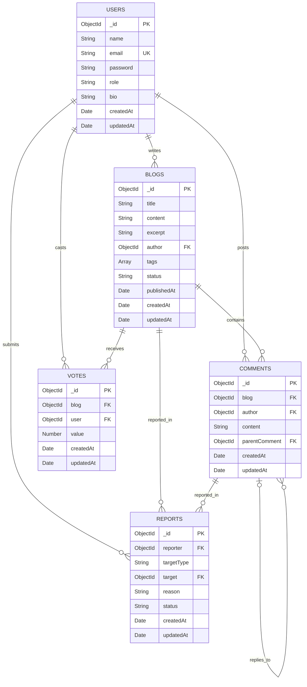

# Bloggr — Database Design

## 1. Overview

Bloggr uses **MongoDB** as its database and **Mongoose** as its Object Data Modeling (ODM) library. MongoDB stores data as BSON documents inside collections, while Mongoose defines schemas, validates data, and provides methods to interact with the database.

The database consists of five main collections:

1. `users`
2. `blogs`
3. `comments`
4. `votes`
5. `reports`

Each collection represents a specific entity in the blogging platform. Related documents are connected using MongoDB ObjectId references.

## 2. Database Architecture

*Note: The diagram shows logical relationships. MongoDB does not automatically enforce foreign-key constraints like a relational database.*

## 3. Collection Design

### 3.1 Users Collection

**Purpose:** Stores registered user accounts, profile information, and role-based access information.

| Field | Data type | Description |
|---|---|---|
| `_id` | ObjectId | Unique identifier generated by MongoDB |
| `name` | String | User's display name |
| `email` | String | Unique email address, stored in normalized form |
| `password` | String | Bcrypt-hashed password |
| `role` | String | `user` or `admin`; defaults to `user` |
| `bio` | String | Optional profile biography |
| `createdAt` | Date | Account creation timestamp |
| `updatedAt` | Date | Last update timestamp |

**Important rules:**
- Email addresses must be unique.
- Passwords are hashed before being stored.
- Public registration creates normal user accounts.
- The application is designed for one administrator account, created through the admin seeding script.
- The password field should never be included in public API responses.

### 3.2 Blogs Collection

**Purpose:** Stores blog posts created by users.

| Field | Data type | Description |
|---|---|---|
| `_id` | ObjectId | Unique blog identifier |
| `title` | String | Blog post title |
| `content` | String | Main body of the post |
| `excerpt` | String | Short summary of the post |
| `author` | ObjectId | Reference to the author in `users` |
| `tags` | Array of Strings | Tags used to categorize posts |
| `status` | String | `draft` or `published` |
| `publishedAt` | Date | Publication timestamp, when applicable |
| `createdAt` | Date | Creation timestamp |
| `updatedAt` | Date | Last modification timestamp |

**Important rules:**
- Each blog belongs to one author.
- Authors can manage their own posts, subject to authorization rules.
- Draft posts are not publicly available as published posts.
- Published posts can be searched, filtered, and paginated.
- The `author` field references a document in the `users` collection.

### 3.3 Comments Collection

**Purpose:** Stores comments on blog posts and replies to existing comments.

| Field | Data type | Description |
|---|---|---|
| `_id` | ObjectId | Unique comment identifier |
| `blog` | ObjectId | Reference to the related blog |
| `author` | ObjectId | Reference to the commenting user |
| `content` | String | Comment text |
| `parentComment` | ObjectId or null | Reference to a parent comment; null for a top-level comment |
| `createdAt` | Date | Creation timestamp |
| `updatedAt` | Date | Last modification timestamp |

**Important rules:**
- Each comment belongs to a blog and an author.
- A top-level comment has no parent.
- A reply references its parent through `parentComment`.
- The application supports one level of replies.
- Comment deletion is restricted by the application's authorization rules.

### 3.4 Votes Collection

**Purpose:** Stores user votes on blog posts.

| Field | Data type | Description |
|---|---|---|
| `_id` | ObjectId | Unique vote identifier |
| `blog` | ObjectId | Reference to the voted blog |
| `user` | ObjectId | Reference to the voting user |
| `value` | Number | `1` for an upvote or `-1` for a downvote |
| `createdAt` | Date | Creation timestamp |
| `updatedAt` | Date | Last update timestamp |

**Important rules:**
- A user can have at most one vote record per blog.
- A compound unique index on `{ blog, user }` enforces this restriction.
- A vote can be changed or removed through the application's vote-toggle logic.
- Authors cannot vote on their own posts, according to the application's rules.

The compound unique index is important because it prevents duplicate votes even when multiple requests attempt to create them.

### 3.5 Reports Collection

**Purpose:** Stores reports submitted by users about inappropriate blog posts or comments.

| Field | Data type | Description |
|---|---|---|
| `_id` | ObjectId | Unique report identifier |
| `reporter` | ObjectId | Reference to the user submitting the report |
| `targetType` | String | `Blog` or `Comment` |
| `target` | ObjectId | Reference to the reported document |
| `reason` | String | Explanation for the report |
| `status` | String | `pending`, `reviewed`, `resolved`, or `rejected` |
| `createdAt` | Date | Creation timestamp |
| `updatedAt` | Date | Last update timestamp |

**Important rules:**
- Reports can target either a blog or a comment.
- The `target` field uses Mongoose's `refPath` mechanism to determine which model it references.
- Reports are submitted by authenticated users.
- Administrators can review reports and update their status.

## 4. Relationships Between Collections

| Relationship | Type | Explanation |
|---|---|---|
| User → Blog | One-to-many | One user can write multiple blogs. |
| User → Comment | One-to-many | One user can post multiple comments. |
| Blog → Comment | One-to-many | One blog can contain multiple comments. |
| User → Vote | One-to-many | One user can vote on multiple blogs. |
| Blog → Vote | One-to-many | One blog can receive votes from multiple users. |
| User → Report | One-to-many | One user can submit multiple reports. |
| Blog/Comment → Report | One-to-many | A blog or comment can be the target of multiple reports. |
| Comment → Comment | Self-referencing | A comment can have replies linked through `parentComment`. |

## 5. Indexes and Constraints

Indexes improve query performance and enforce selected uniqueness rules.

| Collection | Index or constraint | Purpose |
|---|---|---|
| `users` | Unique `email` | Prevent duplicate accounts using the same email |
| `blogs` | `status` and `publishedAt` | Support published-post queries and sorting |
| `blogs` | `tags` and `status` | Support tag-based filtering |
| `blogs` | `author` and `status` | Support queries for an author's posts |
| `votes` | Unique compound index on `blog` and `user` | Prevent multiple vote records from one user on one blog |

Mongoose's `timestamps` option automatically maintains `createdAt` and `updatedAt` on the applicable schemas.

## 6. Data Validation

Validation is applied through Mongoose schemas and application service logic.

- **Users:** required fields, normalized email, unique email, and password length checks.
- **Blogs:** schema-defined fields and allowed status values.
- **Comments:** required comment data and parent-comment handling.
- **Votes:** only `1` and `-1` are valid vote values.
- **Reports:** target type and report status must use allowed values.

Authentication and authorization checks are performed by the application before protected operations. A schema reference alone does not guarantee that a referenced document exists or that the current user has permission to access it.

## 7. Data Storage and Security

1. MongoDB stores application records in the five collections.
2. Mongoose models define the structure and validation rules for those records.
3. Services perform database operations and apply business logic.
4. Controllers process requests and return API responses.
5. Authentication middleware protects routes that require a logged-in user or administrator privileges.

Passwords are stored as bcrypt hashes rather than plaintext. Database connection details are supplied through environment variables, such as `MONGO_URI`.

## 8. Design Decisions

### Why MongoDB?

- Document-based storage fits blog content, tags, and profile information.
- Mongoose provides schemas and validation on top of MongoDB.
- ObjectId references allow related records to be connected without storing entire user or comment documents repeatedly.
- The database can accommodate future fields as the application develops.

### Why store votes separately?

A separate `votes` collection records each user's vote on a blog and allows a unique compound index to prevent duplicate votes. Vote totals can be calculated from these records.

### Why use a separate reports collection?

Reports need their own status and moderation workflow. Keeping them separate from blogs and comments makes it easier to track reported content and manage review decisions.

## 9. Conclusion

Bloggr's database design uses five collections to manage users, blog posts, comments, votes, and moderation reports. ObjectId references represent relationships between documents, while Mongoose schemas, validation, and indexes help maintain data consistency.

The design supports the platform's main features, including authentication, publishing, commenting, voting, user profiles, and administrator moderation.

---

**Implementation reference:** The Mongoose schemas in `src/models/` are the source of truth for the implemented fields and constraints. This document describes the intended database design and should be updated if those schemas change.