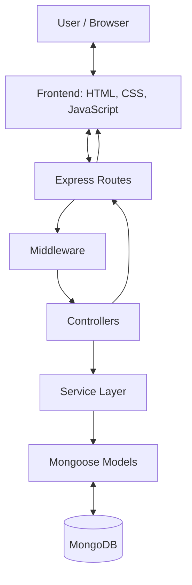

# Bloggr — System Design

## 1. Overview


The application follows a **Model–View–Controller (MVC)-inspired architecture**, with a service layer for business logic.

## 2. Technology Stack

| Component | Technology |
|---|---|
| Runtime | Node.js |
| Backend framework | Express.js |
| Database | MongoDB |
| Object data modeling | Mongoose |
| Frontend | HTML, CSS, JavaScript |
| Authentication | Express Session |
| Password hashing | bcrypt |
| Version control | Git and GitHub |

## 3. System Architecture

Bloggr uses a single Express application to serve the frontend and handle backend API requests. The backend is organized into routes, middleware, controllers, services, and models.



### Architectural Components

- **View:** HTML pages, stylesheets, and JavaScript files in `public/` form the user interface.
- **Routes:** Define API endpoints and connect requests to controller functions.
- **Middleware:** Performs authentication, authorization checks, and request rate limiting.
- **Controllers:** Handle HTTP requests, call services, and return JSON responses.
- **Services:** Contain application logic, validation, and database operations.
- **Models:** Define MongoDB document structures and constraints using Mongoose.
- **Database:** Stores user accounts, blogs, comments, votes, and reports.

## 4. Project Structure

```text
Blogger/
├── public/                  # Frontend pages and assets
│   ├── index.html
│   ├── explore.html
│   ├── login.html
│   ├── register.html
│   ├── post.html
│   ├── editor.html
│   ├── profile.html
│   ├── admin.html
│   ├── shared.js
│   └── style.css
├── scripts/
│   └── seedAdmin.js         # Administrator account setup
├── src/
│   ├── config/
│   │   └── database.js     # MongoDB connection
│   ├── controllers/        # HTTP request handlers
│   ├── middleware/         # Authentication and rate limiting
│   ├── models/             # Mongoose schemas
│   ├── routes/             # API endpoint definitions
│   └── services/           # Business logic
├── server.js               # Express application entry point
├── package.json
├── package-lock.json
├── .gitignore
└── README.md
```

## 5. Request Processing Flow

A typical request follows these steps:

1. The user performs an action on a frontend page.
2. Frontend JavaScript sends an HTTP request to the corresponding API endpoint.
3. Express routes the request to the appropriate handler.
4. Middleware checks whether authentication or other access restrictions apply.
5. The controller extracts request data and invokes the relevant service.
6. The service validates the operation and interacts with Mongoose models.
7. Mongoose reads or modifies the corresponding MongoDB documents.
8. The controller returns a JSON response to the frontend.
9. The frontend updates the interface based on the response.

For example, publishing a blog involves sending the article data to `POST /api/blogs`. Authentication middleware checks the session, the controller calls the blog service, and the service creates the blog document in MongoDB.

## 6. Database Design

Bloggr uses MongoDB collections represented by five primary Mongoose models.

| Model | Purpose | Important relationships |
|---|---|---|
| `User` | Stores accounts, password hashes, roles, and profile information | Users can author blogs and comments |
| `Blog` | Stores article content, tags, status, and publication details | References its author |
| `Comment` | Stores comments and replies | References a blog, author, and optional parent comment |
| `Vote` | Stores upvotes and downvotes | References a user and blog |
| `Report` | Stores reports submitted for moderation | References a reporter and a blog or comment |

### Relationships and Constraints

- A user can create multiple blogs and comments.
- A blog can have multiple comments and votes.
- Comments support one level of replies through the `parentComment` reference.
- Each vote references one user and one blog. A compound unique index on `{ blog, user }` prevents duplicate vote records for the same pair.
- Reports use `targetType` and `refPath` to reference either a blog or a comment.
- Blogs have `draft` or `published` status.
- Mongoose timestamps record creation and update times for the models configured with timestamps.

## 7. Authentication and Authorization

Bloggr uses session-based authentication.

1. During registration, the password is hashed using bcrypt before being stored.
2. During login, bcrypt compares the submitted password with the stored hash.
3. Successful authentication stores the user's ID and role in the Express session.
4. The session identifier is sent to the browser in an HTTP-only cookie.
5. Protected routes use middleware to check the session and restrict access.

### Roles

- **User:** Can manage their own blogs and profile, comment, vote, and submit reports.
- **Administrator:** Has additional privileges for moderation and user management.

There is one intended administrator account, created through `scripts/seedAdmin.js`. Public registration assigns regular-user privileges rather than allowing users to choose their own role.

## 8. Main Functional Modules

### Authentication
Registration, login, logout, and retrieval of the current user's session.

### Blog Management
Creating and editing articles, saving drafts, publishing posts, deleting posts, and browsing published content with search, tag filtering, and pagination.

### Comments and Voting
Posting comments and replies, deleting permitted comments, and casting or changing votes.

### User Profiles
Viewing profiles, updating profile information, and deleting accounts.

### Content Moderation
Submitting reports, reviewing reports, changing report statuses, and managing users through administrator-only endpoints.

## 9. Error Handling

The application returns JSON responses with appropriate HTTP status codes for common outcomes, including:

- `200 OK` — successful operation.
- `201 Created` — resource created.
- `400 Bad Request` — invalid input or rejected operation.
- `401 Unauthorized` — authentication required.
- `403 Forbidden` — insufficient permissions.
- `404 Not Found` — resource not found.
- `409 Conflict` — duplicate account or conflicting resource, where handled.
- `429 Too Many Requests` — rate limit exceeded.
- `500 Internal Server Error` — unexpected server failure.

A centralized Express error handler handles errors passed to Express middleware, while controllers also handle expected errors from service operations.

## 10. Deployment Architecture

The application can be deployed as one Express application with its frontend served from `public/`.

A planned cloud deployment consists of:

- **Vercel:** Application hosting.
- **MongoDB Atlas:** Managed database hosting.
- **GitHub:** Source code and version control.

Environment variables such as `MONGO_URI` and `SESSION_SECRET` configure the deployment. The database must be reachable from the hosting environment.

## 11. Design Summary

Bloggr separates HTTP handling, business logic, and database access to make the application easier to understand, maintain, and extend. Its modular structure supports collaboration among team members while keeping the frontend, backend functionality, and data models organized.

